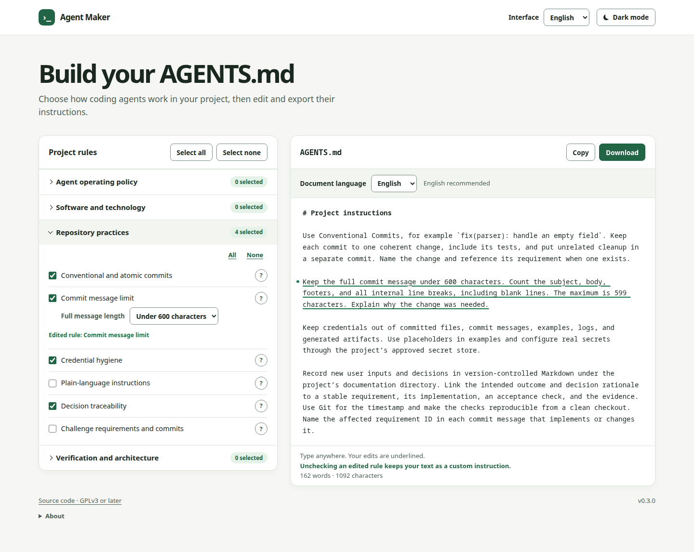

# Agent Maker

[](https://github.com/marcelpetrick/AgentsTemplateMaker/actions/workflows/ci.yml)
[](https://github.com/marcelpetrick/AgentsTemplateMaker/actions/workflows/pages.yml)
[](package.json)
[](LICENSE)
[](https://www.typescriptlang.org/)
[](https://vite.dev/)
[](#local-development)
[](#local-development)
[](#using-agent-maker)

Compose an `AGENTS.md` for your repository. Choose project rules, edit the
generated Markdown directly, and copy or download the draft with your own
instructions intact. The draft lives in your open browser tab.

**[Open Agent Maker on GitHub Pages](https://marcelpetrick.github.io/AgentsTemplateMaker/)**

**Author** Marcel Petrick ([mail@marcelpetrick.it](mailto:mail@marcelpetrick.it)) · **Runtime library** [CodeMirror 6](https://codemirror.net/) (MIT) · **License** [GPL v3 or later](LICENSE) · Developed with AI assistance.



## Using Agent Maker

1. Open a category by hovering over its heading, clicking, or pressing Enter.
   Use a rule’s **?** button to read its benefits and trade-offs.
2. Pick your project rules. Conventional atomic commits, a strict 300-character
   commit-message limit, credential hygiene, and decision traceability are
   selected by default. The message limit also offers 600 characters.
   **Select all** and **Select none** act on every rule; **All** and **None**
   inside a category act on that category only. Languages and frameworks
   offer common choices such as Python, C++, Qt, LVGL, TouchGFX, ESP-IDF,
   FreeRTOS, TypeScript, and Rust. The character set rule chooses Unicode or
   ASCII only.
3. Type or paste anywhere in the Markdown editor. Your edits are underlined.
   Unchecking an edited rule keeps that text as a custom instruction. A
   setting or document language change that affects edited rules lists the
   affected paragraphs and gives you a chance to cancel.
4. Choose English or German for the interface. While you have not edited the
   draft, the document follows that language. After an edit, the document
   language changes only when you pick it yourself. English is recommended
   for repository instructions. The light and dark
   theme controls preserve the current draft and editor selection.
5. The footer below the editor shows the draft's word and character count.
   **About** names the author, the project, and the bundled libraries.
6. **Copy** or **Download** the current Markdown, then place it in your project
   as `AGENTS.md`. Export before closing the tab to keep a copy.

## Local development

Use Node.js 24.20.0, npm, Bash, and Git. The reference pipeline environment is
Ubuntu 24.04 x86-64. npm and the Playwright browser downloads need network access.

```sh
npm ci
npm run dev
```

Open the URL printed by Vite. A production build goes to `dist/`. Use
`npm run preview` after `npm run build` to preview it locally.

```sh
./localPipeline.sh
```

The pipeline installs locked dependencies and pinned Playwright browsers, checks
formatting, lint, shell syntax, and types, runs unit and browser integration
tests with a 95% project-wide executable-line coverage gate, runs mutation
testing with an 85% score gate, builds the static
site, and runs end-to-end tests against the built Pages subpath in Chromium,
Firefox, and WebKit. On a fresh Ubuntu machine, use
`PLAYWRIGHT_INSTALL_SYSTEM_DEPS=1 ./localPipeline.sh` to install Playwright's
OS packages as well. That step may require `sudo`. Other Linux distributions
need compatible Playwright browser libraries.

- `npm test` runs unit and Chromium integration tests. `npm run coverage` adds
  the coverage gate and writes `coverage/index.html`.
- `npm run mutation` runs mutation testing and writes
  `reports/mutation/index.html`. See [the quality gates](docs/quality.md).
- `npm run test:e2e` tests the production build. Run `npm run build` first.
  The terminal lists the browser results. Failure traces go to `test-results/`.
- `npm run format` applies Prettier formatting.
- `./scripts/checkStaged.sh` exports Git's staged tree to an isolated directory
  and runs the pipeline there. The script fails if the staged tree changes during
  the check.
- `./scripts/captureScreenshot.sh` rebuilds the site and writes
  `docs/interface.png` from a real Chromium session. It uses the Playwright
  browser installed by the pipeline and needs local port 4173.

## Publication and verification

The [CI workflow](.github/workflows/ci.yml) runs the same pipeline on GitHub.
The [Pages workflow](.github/workflows/pages.yml) publishes the verified tip of
`main` when CI succeeds. Enable **GitHub Actions** as the Pages source on a new
repository. The workflow uses GitHub's built-in token and OIDC permissions. It
needs no repository secrets.

The hosted build includes the full project license and the bundled dependency
notices. [GPLv3](https://marcelpetrick.github.io/AgentsTemplateMaker/LICENSE.txt)
· [Dependency licenses](https://marcelpetrick.github.io/AgentsTemplateMaker/dependency-licenses.md)

Follow [the plan](plan.md), [the recorded decisions](docs/decisions.md), and
[the requirements and checks](docs/requirements.md) to review a change.
See the [C4 architecture views](docs/architecture.md) for the application
boundaries, and [AGENTS.md](AGENTS.md) for contributor rules.
[Code quality gates](docs/quality.md) lists the lint limits and analysis tools.
