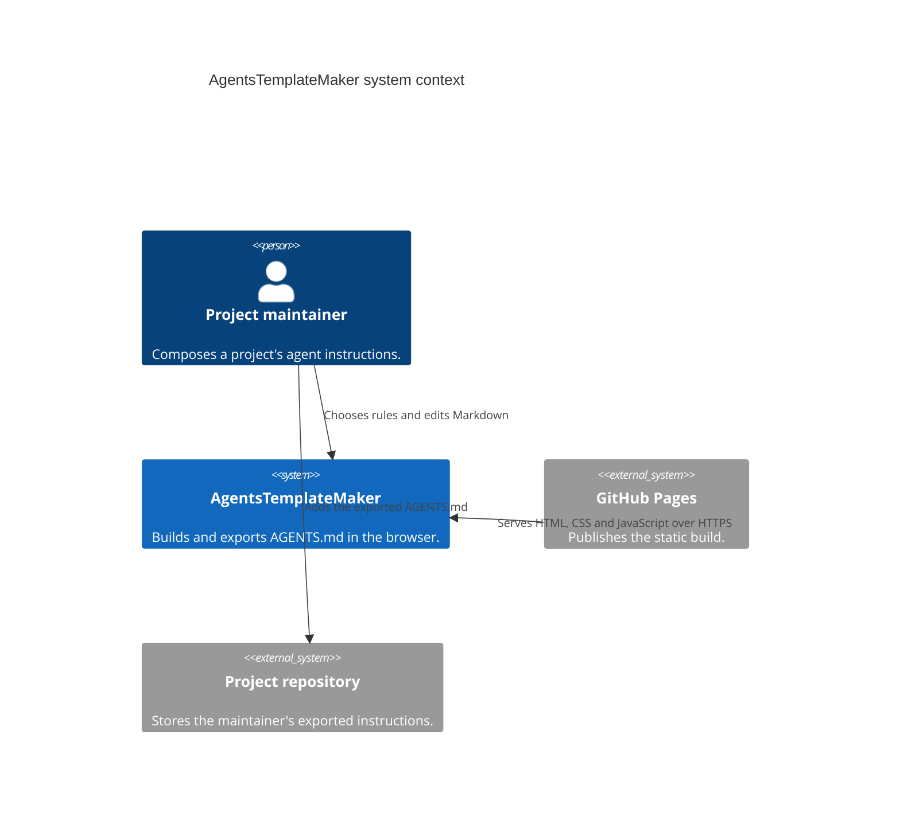
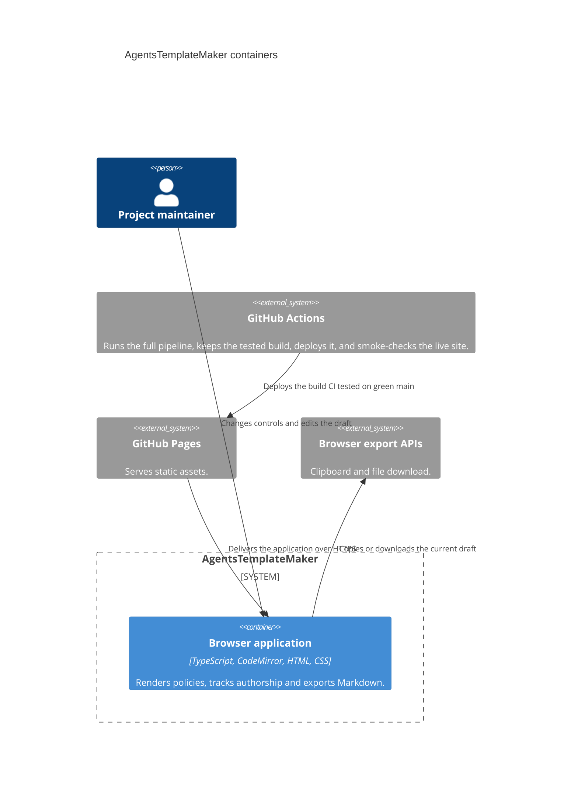
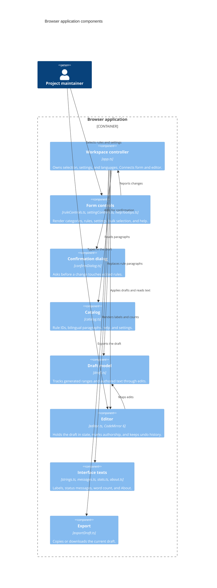

# Architecture

## C4 system context

## C4 containers

The browser app holds the draft in memory and keeps a copy in the browser's local
storage. It has no API server or database. GitHub
renders the Mermaid source in this file.

## C4 components of the browser application

## Browser application responsibilities

- [Catalog](../src/catalog.ts) defines stable category and rule IDs, paired
  translations, explanatory text, defaults, and optional setting metadata.
- [Draft model](../src/draft.ts) tracks generated contributions and separators by
  range. A rule's identity is independent of its wording. CodeMirror change sets
  map offsets through direct edits and form changes. Detached and independent
  text survives later rule operations.
- [Editor](../src/editor.ts) stores the draft model in a CodeMirror state field
  and derives authorship decorations. CodeMirror handles keyboard input,
  selection, and undo for direct edits. History records the affected rule IDs
  and relative offsets of generated text removed by a selection. Exact inverse
  edits can restore those ranges while keeping form choices and authored copies.
- [Workspace controller](../src/app.ts) connects the form and editor. It stages
  a setting or output-language change that affects edited rules until the user
  confirms in the [confirmation dialog](../src/confirmDialog.ts).
  [Copy and download](../src/exportDraft.ts) read the same current draft.
- [Rule controls](../src/ruleControls.ts) and
  [setting controls](../src/settingControls.ts) render the form.
  [Help tooltips](../src/helpTooltips.ts) show one rule explanation at a time.
- [Workspace controller](../src/app.ts) also lets the document language follow
  the interface language while the draft has no authored text. Once the user
  edits, an interface language change leaves the editor text, output language,
  and selection in place.
- [Interface strings](../src/strings.ts) and
  [status messages](../src/messages.ts) hold every visible English and German
  text. [Text statistics](../src/stats.ts) count words and user-perceived
  characters and fall back when `Intl.Segmenter` is missing.
  [About](../src/about.ts) lists the runtime libraries from `package.json`.
- [DOM helpers](../src/dom.ts) look up typed page elements and create controls.
